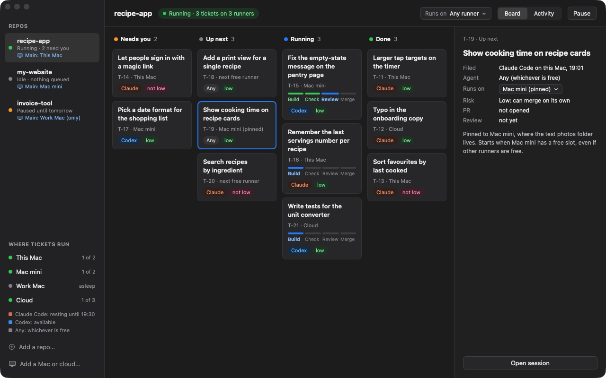

# Agent Runway

**A ready-made software factory for one.** Keep working in Claude Code or Codex the way you do now. When part of the
job can run on its own, file it as a ticket. Runway runs it on your Mac, has a fresh session review it, and only
merges what is low risk.

Website: **[agentrunway.app](https://agentrunway.app)** · Free · Source available · macOS 14 or later



> **Early preview.** Runway runs real tickets today. Signed, notarised and self-updating.
> [Download Runway.dmg](https://github.com/datacraftdevelopment/agent-runway/releases/latest/download/Runway.dmg).

## How it works

You decide what to build, and Runway builds it.

1. **Discover, prototype, spec.** You and your agent talk the work through in a normal session, try a throwaway
   prototype if a design question needs one, and write a spec that says what done looks like and how to check it.
2. **Tickets.** Your agent breaks the spec into small tickets, each with its risk and acceptance checks. Nothing is
   filed until you type go (`file-tickets` skill).
3. **Build and check.** Each ticket runs headless in its own git worktree, inside tmux, so closing the app doesn't kill
   it. Then two fresh sessions review it: one reads the code, the other runs every acceptance check.
4. **Merge.** Low-risk work that passes review and checks merges itself. Anything else waits on your board as one
   question with its pull request. A stuck ticket can be taken back into a normal session and handed back.

The full workflow and every skill in it: [agentrunway.app/skills](https://agentrunway.app/skills).

## What it is, and isn't

- **One subscription is enough.** Tickets run with the Claude Code or the Codex you already sign in to. No API keys,
  no service in between. With both, the code review goes to the other agent, and when one hits its usage limit the
  next tickets go to the other.
- **Nothing hosted.** One SQLite file on your Mac (`~/.runway/runway.db`) holds every ticket and run. Specs and code
  stay in your git repos.
- **Nothing hidden.** The loop runs only while the app is open, as its child. No daemons, no launch agents.
- **A gate written in code.** Auto-merge needs low risk (set when the work was shaped), a passing review on the exact
  commit, green checks, and no sensitive paths (auth, payments, migrations, CI, `runway.json`). A reviewer can raise
  risk, never lower it.
- **Mac only, one Mac for now.** Other Macs over SSH are next; cloud runs after that.

## Install

**The app (recommended):** download `Runway.dmg` from
[Releases](https://github.com/datacraftdevelopment/agent-runway/releases/latest), drag Runway to Applications and open
it. Its first-run screen checks your tools and sign-ins, installs the `runway` command and adds the Agent Runway skills
to Claude Code and Codex.

**From source** (needs the Xcode Command Line Tools, Python 3, git, tmux, `gh`, and Claude Code or Codex):

```bash
git clone https://github.com/datacraftdevelopment/agent-runway
cd agent-runway/app
bash make-app.sh --open      # builds build/Runway.app and opens it
```

Then, in Claude Code or Codex, run the `setup` skill (or follow the app's first run) to check sign-ins and add a first
repo with its test command.

## The skills

The plugin in [`plugin/agent-runway`](plugin/agent-runway) works in both Claude Code and Codex. The app installs it on
first run, and it is the only plugin Runway needs.

| Skill | What it does |
| --- | --- |
| `map` | Charts work too big for one session as a map of decisions, settled one at a time across sessions. |
| `grill` | Interviews you about the plan, one question at a time, until nothing that changes the build is open. |
| `prototype` | Builds a throwaway to settle one design question by seeing it. |
| `spec` | Writes the spec: what it does, what it leaves out, its risk, and acceptance checks. |
| `file-tickets` | Proposes a short batch of tickets from your session and files them on your go. |
| `runway` | What's running, what needs you, pause and resume, go or no on a waiting ticket. |
| `setup` | Checks this Mac's tools and sign-ins, walks you through each fix, adds a first repo. |
| `take-back` | Brings a stuck ticket into your session to finish, then hands it back or closes it. |

The shaping skills (map, grill, prototype, spec) are inspired by Matt Pocock's open
[skills](https://github.com/mattpocock/skills); Runway's versions are written for unattended tickets.

## Repository

| Path | What's there |
| --- | --- |
| `app/` | The SwiftUI menu bar app (`swift build && swift test`; releasing: `app/RELEASING.md`) |
| `runway/`, `bin/runway` | The `runway` command: every rule lives here, stdlib Python (`python3 -m unittest`) |
| `plugin/` | The Agent Runway skills for Claude Code and Codex |
| `site/` | The website, deployed to agentrunway.app from `main` |
| `docs/` | Designs (`docs/specs/`), plans, quirks |

## Feedback and contributing

Bugs and ideas: [open an issue](https://github.com/datacraftdevelopment/agent-runway/issues/new/choose). This repo is
public, so leave out secrets, private repo names and anyone else's code.

Pull requests are welcome; see [CONTRIBUTING.md](CONTRIBUTING.md). The first one asks you to accept the
[Contributor Licence Agreement](CLA.md) with a single comment.

## Licence

Source available under the [PolyForm Shield License 1.0.0](LICENSE): free to use, change and share for any purpose
except providing a product that competes with Agent Runway. Third-party code vendored into this repo keeps its own
licence, recorded beside it.

Made by DataCraft Development.
